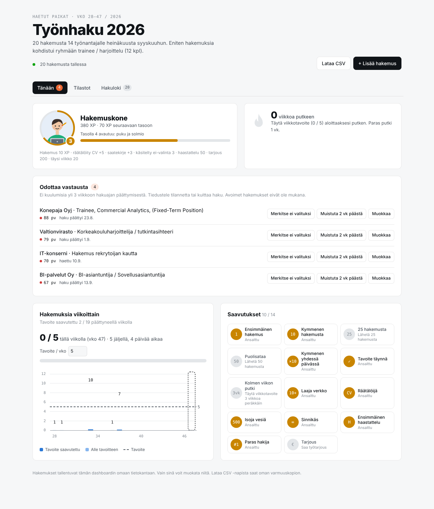

# Työnhaku-dashboard

Oma työnhaun seurantatyökalu, jossa hakemukset, odottavat haut ja viikkotavoite näkyvät yhdessä näkymässä. Ulkoasu on tumma JRPG-valikko: hakijalla on pikselihahmo, taso ja esineinä kerättävät saavutukset.

**[Kokeile demoa →](https://robertovit.github.io/tyonhaku-dashboard/)** Demossa on keksittyä esimerkkidataa. Voit lisätä ja muokata hakemuksia vapaasti, ja muutokset tallentuvat vain omaan selaimeesi.



Kuvakaappauksen ja demon hakemukset ovat keksittyä esimerkkidataa. Omat hakemukseni eivät ole tässä repossa.

## Mitä se tekee

- **Tänään:** hahmo, sen kilpi ja postiesine (**Vaihda varusteita** vie Varusteisiin), taso muodossa "LVL 4", "243 XP seuraavaan tasoon", "Tällä viikolla 2 / 3 hakemusta" ja putki. **Tallennetut paikat** määräaikoineen (kalenteri, esim. "Haku päättyy 3 pv päästä") ja **Seurattavat haut**: hakemukset, joista ei ole kuulunut yli kolmeen viikkoon (kello, "Odottanut 47 pv"). Seurattavista näkyy ensin kolme, ja **Näytä kaikki** avaa loput. Rivi avaa alleen toiminnot: **Muistuta 2 viikon päästä**, **Kirjaa hylkäys** (lyhyt tilaikkuna, jossa päivän voi vaihtaa) tai muokkaa.
- **Varusteet:** hahmon esikatselu ja kolme kilpeä, jotka avautuvat kirjatuista hylkäyksistä (1, 5 ja 10). Kilpeä voi esikatsella (myös lukittua, jolloin näkyy ansaintaehto), ja esikatselun vieressä oleva **Ota käyttöön** pukee sen hahmolle. **Postisarja** toimii samoin: hakemusetapit 1, 10, 25, 50, 100 ja 200 lähetettyä hakemusta avaavat Kirjekuoren, Lähettilaukun, Postileimasimen, Puolisataa-postilaatikon, Postikärryn ja Tavarafillarin, joista yhtä hahmo kantaa kilven rinnalla. Jokainen lähetetty hakemus lasketaan kerran, ja esineet ovat pelkkiä koristeita (ei XP:tä). Seuraavan etapin edistyminen näkyy mittarina, ja muut merkit kertovat, miten ne saa ja miltä viikolta ne on ansaittu. Haastattelu-, sijoitus- ja tarjousmerkit ovat avattavan kohdan **Aiemmat merkit** alla.
- **Tilastot:** hakemukset viikoittain tavoiterajan kanssa, lopputulokset (nykytila, esim. Haastatteluvaiheessa), suppilo hausta tarjoukseen (Edennyt haastatteluun lasketaan kaikista vaiheista), tehtävätyypit, työnantajat ja hakijamäärät.
- **Hakuloki:** kaikki hakemukset tilan mukaan suodatettavina ja **CSV-lataus** (kaikki hakemukset ja tallennetut paikat suodattimesta riippumatta). Puhelimessa jokainen haku on kortti: tehtävä, työnantaja, tila ja lähetyspäivä, **Päivitä tila** ja **Tapahtumat** (aikajana avautuu korttiin), ja XP, hakijamäärä, ilmoitus ja muokkaus kohdassa **Lisätiedot**. Työpöydällä sama lista on vertailtava taulukko. **Päivitä tila** on lyhyt ikkuna: uusi tila, päivä jolloin tieto tuli ja Tallenna. Aiempi haastattelu pysyy historiassa, vaikka haku päättyisi myöhemmin hylkäykseen. Väärän merkinnän voi korjata muokkausikkunan kohdasta **Korjaa historiaa**.
- **Tallennetut paikat:** kiinnostavan ilmoituksen voi ottaa talteen ennen kuin hakee. Lista järjestyy määräajan mukaan. **Merkitse haetuksi** kysyy vain lähetyspäivän, ja toteutunut XP näkyy tallennuksen jälkeen.
- **Lisää hakemus:** ensin työnantaja, tehtävä, ilmoituslinkki ja tilanteeseen sopiva päivä; CV-versio, liitteet, hakutapa ja hakijamäärä ovat kohdassa **Lisätiedot**. PALKKIO-paneeli näyttää, paljonko XP:tä tallennus tuo ja miten viikkotavoite etenee. Puhelimessa Tallenna pysyy näkyvissä myös näppäimistön ollessa auki.
- **Puhelimessa:** sovelluksen voi asentaa aloitusnäytölle (PWA). Androidissa se näkyy Jaa-valikossa, joten ilmoituksen saa talteen suoraan LinkedInistä tai selaimesta. Työnantaja, tehtävä ja tehtävätyyppi täyttyvät jaetusta ilmoituksesta valmiiksi.
- **Pelisäännöt** palkitsevat tekemistä, eivät lopputulosta, joten myös käsitelty hylkäys tuottaa XP:tä. Saavutettu vaihe pysyy: haastattelun jälkeinen hylkäys ei vie haastattelun pisteitä.
- Tumma ja vaalea teema. Valikossa on pikseli-ikonit, ja mobiilissa se on alapalkki. Näkymä näkyy osoitteessa (esim. `#varusteet`), joten siihen voi linkittää ja selaimen takaisin-painike toimii.

## Tekniikka

React 19, TypeScript, Vite ja visx (D3:n asteikot ja muodot kaavioihin). Testit Vitestillä, lint ESLintillä ja muotoilu Prettierillä.

Sovellus pyörii Cloudflare Pagesissa:

- Palvelinpuoli on Pages Functions -rajapinta, ja data on D1-tietokannassa.
- Cloudflare Access päästää sisään vain omistajan.
- Sovelluksen saa asennettua puhelimeen `vite-plugin-pwa`:n avulla.

Rakenteesta:

- `src/lib/` sisältää puhtaan logiikan ilman Reactia: datamalli, päivämäärät, tilastot, pelisäännöt ja CSV. Päivä annetaan funktioille parametrina, joten testit ovat deterministisiä.
- `src/lib/store.ts` määrittelee rajapinnat, joita käyttöliittymä käyttää. Toteutus on `web.ts`, joka puhuu omalle palvelimelle. `npm run dev` käyttää sen sijaan muistissa toimivaa esimerkkidataa (`src/dev/memory.ts`).
- `functions/` on palvelimen rajapinta. Se tarkistaa kirjautumisen ja validoi jokaisen hakemuksen samalla datamallilla kuin käyttöliittymä.
- `src/components/` on käyttöliittymä ja `src/components/charts/` kaaviot.

## Kehitys

```bash
npm install
npm run dev      # paikallinen versio esimerkkidatalla
npm run check    # tyyppitarkistus, lint ja testit
npm run build    # web-sovellus kansioon dist/
npm run build:demo # julkinen demo kansioon dist-demo/ (GitHub Pages)
npm run serve:web  # koko pino paikallisesti (wrangler + paikallinen D1)
```

`npm run dev` käyttää keksittyä esimerkkidataa. Oman asennuksen ohjeet ovat tiedostossa [docs/KAYTTOONOTTO.md](docs/KAYTTOONOTTO.md).

Tehty Claude Coden kanssa.
